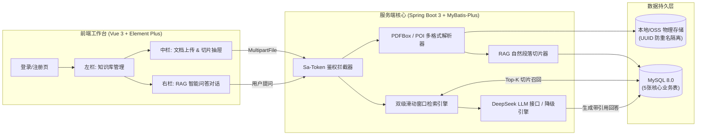

# 🚀 SmartDoc-AI 企业级智能知识库与 RAG 协同问答平台


**SmartDoc-AI** 是一套前后端分离的企业级智能知识库管理与 **RAG（检索增强生成，Retrieval-Augmented Generation）** 协同问答全栈系统。旨在帮助中小企业将散落的规章制度、合同台账、招投标规范等文档（支持 **PDF / Word / TXT / Markdown**）进行自动化文本抽取、语义段落切片与知识库隔离管理，并结合 **DeepSeek / 通义千问** 大语言模型实现**零幻觉、可溯源**的企业内部智能问答。

---

## ✨ 核心架构与工程亮点

1. **🔐 多租户认证与细粒度防越权体系**
   - 基于 **Sa-Token** 实现无状态/会话双模鉴权，利用类级别 `@SaCheckLogin` 拦截器守卫业务网关；
   - 严格区分入参 `DTO` 与持久层 `Entity`，服务端强制从 Token 上下文提取 `ownerId`，结合 `checkKbOwnership` 杜绝水平越权（IDOR）漏洞。
2. **📄 多格式文档解析与 UUID 物理隔离存储**
   - 集成 **Apache PDFBox** 与 **Apache POI**，支持 `.pdf`、`.docx`、`.txt`、`.md` 多格式文档流解析与自动字数统计；
   - 采用**“展示名与物理名分离”**策略，落盘文件采用 `UUID` 重命名防覆盖，并全程使用 `try-with-resources` 自动释放文件句柄，杜绝高并发下内存泄漏。
3. **🧩 RAG 自然段落语义切片与反范式化索引加速**
   - 基于正则自然段落边界（`\r?\n\s*\r?\n`）进行语义完整切分，避免固定字数硬截断导致的语义腰斩；
   - 切片表 `kb_document_chunk` 采用**反范式化设计**冗余 `kb_id` 并建立联合索引，将跨文档检索降维为毫秒级单表索引扫描。
4. **🤖 双级滑动窗口检索与 DeepSeek 大模型防幻觉问答**
   - 内置口语噪音清洗与双字滑动窗口召回算法，精准召回 Top-K 相关知识卡片；
   - 对接 **DeepSeek (`deepseek-chat`)** OpenAI 兼容接口，将采样温度 `temperature` 压低至 `0.2`，并在对话历史中持久化 `matched_chunks` 原文切片编号实现**回答可溯源**；当离线或未配置 Key 时自动优雅降级至本地 RAG 引擎。
5. **💻 Vue 3 + Vite + Element Plus 三栏一体化工作台**
   - 封装 **Axios 双重拦截器**（请求自动注入 `satoken` 凭证、响应统一拆包与 `401` 登录态失效自动重定向）及 **Vue Router 全局前置守卫**；
   - 对标 Dify / NotebookLM 的三栏式交互大屏：左栏知识库管理、中栏文档上传与切片抽屉透视、右栏 AI 溯源聊天窗。

---

## 🏗️ 系统架构流程图



---

## 📂 项目目录结构

```text
smartdoc-ai/
├── smartdoc-server/                 # Spring Boot 3 后端工程 (Port: 8080)
│   ├── src/main/java/com/zhaoce50/smartdocserver/
│   │   ├── common/                  # 统一响应体 Result<T> 与全局异常处理器 GlobalExceptionHandler
│   │   ├── config/                  # Sa-Token 权限拦截器配置
│   │   ├── controller/              # RESTful 控制器 (Auth / KnowledgeBase / Document / Chat)
│   │   ├── dto/                     # 入参校验传输对象 (@Valid / @NotBlank / @NotNull)
│   │   ├── entity/                  # MyBatis-Plus 数据库映射实体 (@TableLogic 软删除)
│   │   ├── mapper/                  # 数据持久层 Mapper 接口
│   │   └── service/impl/            # 核心业务逻辑与 RAG 切片/问答引擎实现
│   └── src/main/resources/
│       └── application.yml          # 数据库、文件上传限额与 DeepSeek LLM 配置
├── smartdoc-web/                    # Vue 3 + Vite 前端工程 (Port: 5173)
│   ├── src/router/                  # Vue Router 路由配置与 beforeEach 登录守卫
│   ├── src/utils/request.js         # Axios 请求/响应全局拦截器
│   └── src/views/                   # Login.vue 登录页 & Workspace.vue 三栏工作台大屏
└── sql/
    └── init_schema.sql              # MySQL 完整建库与核心表 DDL 脚本
```

---

## 🚀 本地快速启动指南

### 1. 初始化数据库
在 MySQL 8.0 中执行 `sql/init_schema.sql` 脚本，自动创建 `smartdoc_ai` 数据库及 `sys_user`、`kb_knowledge_base`、`kb_document`、`kb_document_chunk`、`kb_chat_message` 五张表。

### 2. 启动后端服务 (`smartdoc-server`)
1. 修改 `smartdoc-server/src/main/resources/application.yml` 中的 MySQL 账号密码；
2. （可选）在 `llm.api-key` 中填入 DeepSeek API Key（若留空则自动启用内置本地 RAG 溯源引擎）；
3. 在 IDEA 中运行 `SmartdocServerApplication`，服务默认监听 `http://localhost:8080`。

### 3. 启动前端服务 (`smartdoc-web`)
```bash
cd smartdoc-web
npm install
npm run dev
```
浏览器访问 `http://localhost:5173` 即可注册登录并体验完整 RAG 知识库上传、切片透视与智能问答流程。
